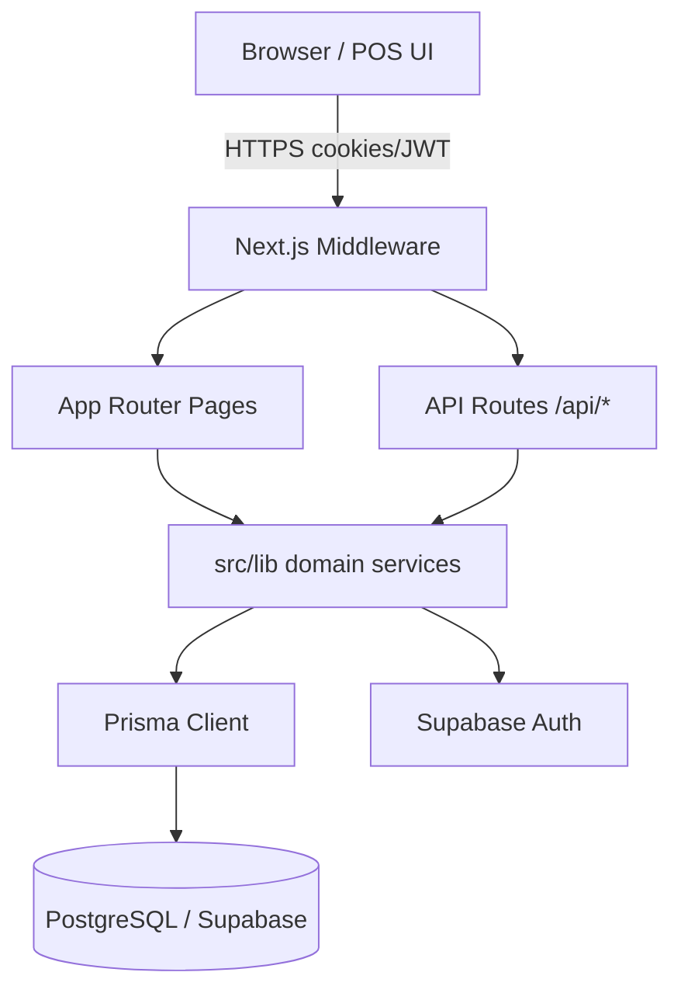
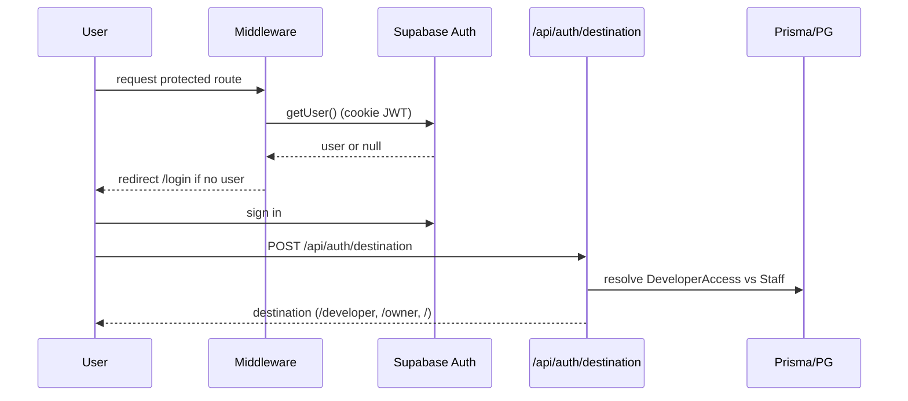
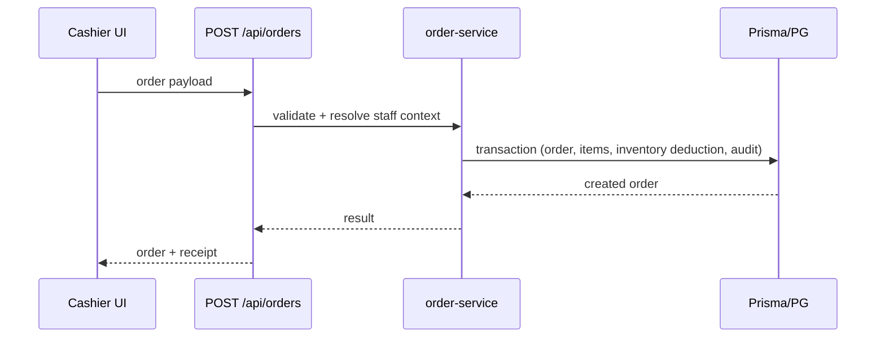

# HANSAN V1 — TECHNICAL ARCHITECTURE

**Audit date:** 2026-10-30

## 1. Technology Stack (verified from package.json, tsconfig.json, prisma/schema.prisma)

| Layer | Technology | Evidence |
|---|---|---|
| Framework | Next.js ^14.2.24, App Router | package.json; src/app |
| Runtime | React ^18.3.1 | package.json |
| Language | TypeScript ^5.7.3 (strict) | tsconfig.json |
| Styling | Tailwind CSS ^3.4.17 + PostCSS | package.json, tailwind.config.ts |
| Database | PostgreSQL (Supabase) | prisma/schema.prisma datasource |
| ORM | Prisma ^5.22.0 | package.json, schema |
| Auth | Supabase SSR/JS | package.json, src/lib/auth.ts, middleware |
| Icons | lucide-react | package.json |
| Utils | clsx, tailwind-merge | package.json |
| Testing | Node test runner + ts-node | package.json scripts |
| Linting | ESLint 8 + eslint-config-next | package.json |
| Build | Next.js compiler | next.config.mjs |

## 2. High-Level Architecture

Modular monolith: single Next.js app with server-side domain logic in src/lib and src/modules, persisted via Prisma to PostgreSQL/Supabase. Auth delegated to Supabase (JWT). Authorization and tenant scoping enforced in app layer and structurally in DB.

## 3. Folder Structure

src/app (pages + api), src/components, src/context, src/hooks, src/lib (services + tests), src/modules/pos, src/middleware.ts. prisma/ (schema + migrations). public/ (assets, SW, manifest). docs/, scripts/.

## 4. Frontend Architecture

App Router with server/client components. Pages under src/app; feature components under src/modules/pos and src/app/owner. Shared shell AppShell, UI primitives ui.tsx, overlays. State: React context (CartContext), local state, useOfflineState. Data access via useApi fetch wrapper. PWA-ish assets: sw.js, manifest, ServiceWorkerRegister, offline.html (offline capture not implemented).

## 5. Backend Architecture

Domain services in src/lib (auth, permissions, order-service, order-lifecycle, inventory-management, catalog-management, role-management, refund-service, etc.). API routes in src/app/api are thin handlers delegating to services and enforcing auth via requireProtectedRequest / requirePlatformAccess. Shared error handling. Prisma singleton src/lib/prisma.ts.

## 6. Database Architecture

PostgreSQL via Prisma. Tenant-ready: Organization -> Outlet -> Staff/Order/Inventory*. Composite FKs pin children to (id, organizationId) so cross-tenant composition is unrepresentable. Immutable inventory ledger (InventoryMovement insert-only). CHECK constraints on quantities.

## 7. Authentication Flow

Middleware performs coarse session-presence only (Edge runtime cannot query DB). Authoritative destination resolved server-side.

## 8. Session Management

Supabase SSR cookies refreshed in middleware on every request. Server-side token validation via service role; never falls back to anon key. resolveAuthenticatedStaffContext() resolves staff, role, permissions from DB per request.

## 9. Permission System (RBAC)

Canonical permission catalog src/lib/permissions.ts (76 permissions seeded). Role (tenant or platform via isPlatform), RolePermission, StaffRole. Fail-closed resolution: non-canonical grant names dropped with warning. Anti-self-escalation on grants tested via real service. Developer/platform access is separate DeveloperAccess table (tenant-independent), never via StaffRole.

## 10. State Management

React context + local state; no global store. Cart state in CartContext. Offline state hook useOfflineState.

## 11. Data Flow (POS checkout)

Client-supplied identity/price fields discarded; prices resolved server-side from MenuItem.

## 12. External Service Dependencies

Supabase (Auth + Postgres hosting). Unsplash (remote images) per next.config.mjs. No payment gateway (manual cash/QRIS/card verification by cashier).

## 13. Deployment

See DEPLOYMENT-AND-INFRASTRUCTURE.md.
